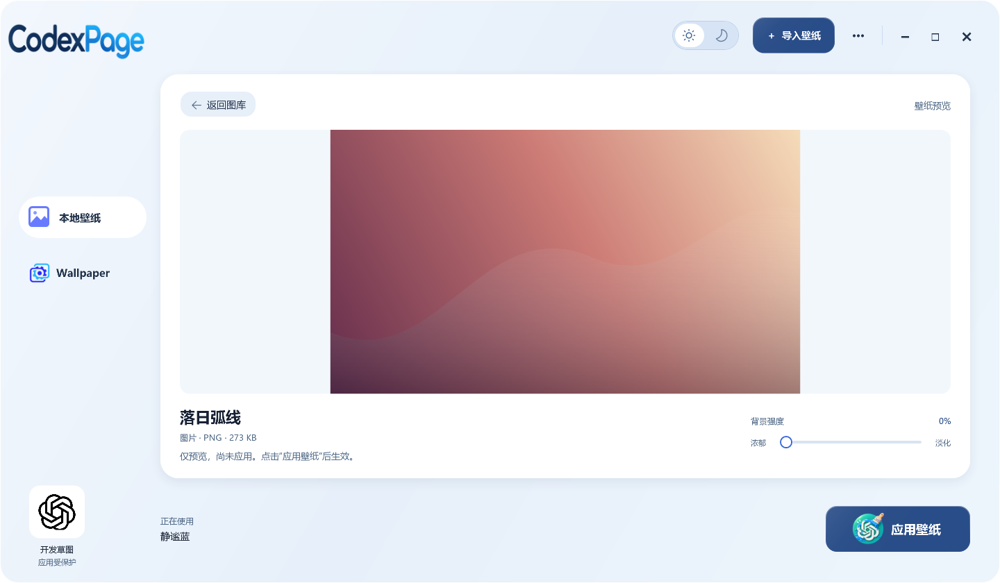

  

Give Codex an image or animated background. Import, preview, and switch wallpapers in one window.

  <a href="https://github.com/JiPaiFan1109/CodexPage/releases/latest/download/CodexPage-Setup.exe"><strong>Download for Windows</strong></a>
  · <a href="README.md">中文</a> · <a href="CHANGELOG.md">Changelog</a>

  
  
  

A community tool, **not an official OpenAI product or affiliated with OpenAI**. Install the official Microsoft Store edition of Codex first. The application interface is currently in Chinese.

## Interface and features

  

CodexPage 3.5.0 focus preview with original demonstration artwork; artwork is not bundled.

- **Day and night appearance:** switch at the top right, retain your preference, and respect reduced motion.
- **Focus preview:** view media at its original aspect ratio and return to the same gallery position.
- **Wallpaper Engine imports:** discover Steam libraries and import supported images, videos, or previews.
- **Images and videos:** import local files and use them as Codex backgrounds.
- **Wallpaper library:** card gallery, image/video filters, large previews, silent video playback, renaming, and deletion.
- **Automatic Codex detection:** the manager locates the supported local client; Apply and Open Codex use the local skin engine.
- **Keep your collection:** local imports retain a copy, so moving their originals does not affect them. Steam references disappear from the gallery when their source is unavailable; the next Codex launch uses its original appearance. Upgrades preserve the library, and you can restore Codex's original appearance.

See an animated background inside Codex

[Watch the full MP4 demo](docs/media/earth-demo.mp4) · [Get the demonstrated Earth wallpaper](docs/earth-background.md)

Recorded from a real Codex window after checking for sensitive information. The original Earth video is not bundled; obtain it according to its creator's terms.

## Install and use

Requires **Windows x64 and the official Microsoft Store edition of Codex**.

**Disk space:** the 3.4.0 application uses approximately **100 MB**, including its bundled runtime and excluding user wallpapers. On-demand FFmpeg, media caches, and update files use additional space.

1. [Download setup](https://github.com/JiPaiFan1109/CodexPage/releases/latest/download/CodexPage-Setup.exe) and run it.
2. Open **CodexPage** and select **导入壁纸** (Import wallpaper) to choose an image or video.
3. Select a wallpaper and click **应用壁纸** (Apply). Save your work before confirming any Codex restart.

**Upgrading:** exit CodexPage and install over the existing version in the same directory. No uninstall is needed; your library and settings are retained. Reapply your wallpaper afterward.

On the first launch each local day, CodexPage checks for updates. Confirm the central notice to download, verify and install; skip applies to that version only. The top-right Check for updates action checks immediately and can show a skipped version.

## Important updates

| Date (Beijing time) | Version | Changes |
| --- | --- | --- |
| 2026-11-07 | [3.6.0](https://github.com/JiPaiFan1109/CodexPage/releases/tag/v3.6.0) | Gallery and startup efficiency, bounded preview cache, import diagnostics and accessible control names |
| 2026-11-05 | [3.5.0](https://github.com/JiPaiFan1109/CodexPage/releases/tag/v3.5.0) | Day/night appearance, focus preview, clearer media labels and safer startup recovery |
| 2026-11-04 | [3.4.0](https://github.com/JiPaiFan1109/CodexPage/releases/tag/v3.4.0) | Add daily update notices, one-confirmation download and install, and restore gallery pagination |
| 2026-11-04 | [3.3.1](https://github.com/JiPaiFan1109/CodexPage/releases/tag/v3.3.1) | Fix update handoff and background PowerShell windows, and speed up connection checks and wallpaper application |
| 2026-11-03 | [3.3.0](https://github.com/JiPaiFan1109/CodexPage/releases/tag/v3.3.0) | Add wallpaper context menus and About; retain and verify the fix for wallpapers reverting after successful application |
| 2026-11-02 | [3.2.0](https://github.com/JiPaiFan1109/CodexPage/releases/tag/v3.2.0) | Improve background recovery and reconnect prompts; preserve unsaved adjustments after save failures; handle inaccessible library folders and damaged previews |
| 2026-10-30 | [3.1.1](https://github.com/JiPaiFan1109/CodexPage/releases/tag/v3.1.1) | Use a single CodexPage Start menu entry and remove known legacy shortcuts |
| 2026-10-28 | [3.1.0](https://github.com/JiPaiFan1109/CodexPage/releases/tag/v3.1.0) | Fix monitor directory handling and duplicate-worker upgrade blockage; load the library before connecting |

[3.6.0 release notes](docs/releases/v3.6.0.md) · [Full changelog](CHANGELOG.md)

## Media and troubleshooting

### Supported media

| Type | Requirements |
| --- | --- |
| Images | PNG, JPG/JPEG, WebP, BMP, TIFF, AVIF; up to 10 MiB; BMP/TIFF/AVIF are converted to PNG |
| Videos and animations | Common videos and GIF/APNG; input up to 2 GiB. Compatible H.264 MP4 files are copied directly; other supported files are converted. Final video limit: 128 MiB; previews and playback are muted. |

Conversion uses on-demand FFmpeg decoding and Windows Media Foundation encoding. If import fails, export an H.264 MP4. Shorten videos that exceed the output limit; the app does not trim them automatically.

The default **Night Sky** image is generated by this project. See the [acquisition guide](docs/earth-background.md) for the demonstrated Earth wallpaper.

Import details and limitations

Steam imports compatible files first and asks before converting remaining items. The first conversion of a video, animation, or AVIF image downloads and verifies FFmpeg from BtbN; later conversions reuse the cache. FFmpeg is not bundled.

Compatible Steam images and videos reference their source files. Removing a source or disconnecting its drive makes the wallpaper unavailable; reconnect the drive and refresh the library to use it again. Other supported media is converted and cached, while retaining its association with the Steam source. Scene and Web projects import preview images or animations only; application projects and full interactive scenes are not supported.

Compatible H.264 MP4 files (up to 1920 × 1080, 60 fps, and 128 MiB, with AAC audio or no audio) can be imported directly. Converted videos use FFmpeg with Windows Media Foundation encoding, up to 1920 × 1080 at 30 fps, without audio. Playback is muted in either case.

Images are limited to 16,384 pixels per side and 50 million pixels in total. Converted images must also fit within 10 MiB; multi-page BMP/TIFF images are rejected. A supported extension alone does not guarantee successful decoding.

### Uninstalling and troubleshooting

- **Uninstall:** use Windows Installed apps. Restoration must finish first; cancellation or failure aborts uninstall. The library is retained.
- **Codex not found:** verify that the current Windows user has the official Store package, then detect again.
- **No skin after using the official entry:** open Codex from the manager or apply a wallpaper again, following any restart prompt.
- **Failure after a Codex update:** client layout and launch behavior can change. Check [Releases](https://github.com/JiPaiFan1109/CodexPage/releases) for compatibility updates.

## Technical details and source builds

Runtime, data locations, and the compatible ZIP workflow (optional reading)

- Setup lets you choose a writable directory, defaulting to `%LOCALAPPDATA%\CodexDynamicSkin`, without administrator privileges. The library is in its `wallpaper-library` directory. Reinstallation defaults to the previous directory and automatic updates target the current installation. Choosing another directory does not migrate the old library.
- Detection uses the registered local Codex package. Applying starts the local engine and verifies the result; detection alone does not apply a skin.
- Default installation, startup, and restoration do not rewrite global `%USERPROFILE%\.codex\config.toml`. Legacy recovery safeguards remain.
- The release bundles pinned Node.js 24.22.1 x64 and its license, verifying SHA-256 and the OpenJS Foundation signature. Project EXEs have no project code-signing certificate; the Node.js signature does not sign this installer. Disabling Windows security is not required.
- The [Release ZIP](https://github.com/JiPaiFan1109/CodexPage/releases) remains available: extract everything and run `Install.cmd`. Automatic source archives do not include the runtime.
- Background processes and videos use memory and CPU/GPU resources. Compatibility with every Codex version and zero overhead are not guaranteed.

Development: [Build guide](docs/windows-application.md) · [3.2.0 validation](docs/releases/v3.2.0-validation.md) · [Security](SECURITY.md)

Historical records: [0.2.0 installation validation](docs/windows-application-validation.md) · [0.2.0 pre-release audit](docs/pre-release-audit.md)

## Attribution and license

Based on [Codex Dream Skin](https://github.com/Fei-Away/Codex-Dream-Skin) v1.5.18, retaining necessary local skin, launch, and recovery implementation.

Project code uses the **[MIT License](LICENSE)** and retains `Copyright (c) 2026 Codex Dream Skin Studio contributors`. [Third-party notices](THIRD_PARTY_NOTICES.md) cover upstream attribution, Node.js licensing, and media boundaries. MIT does not cover third-party wallpapers, OpenAI branding, or official application resources.

## Buy the author a Mixue drink

If this tool helps you, contributions support continued maintenance.

  

