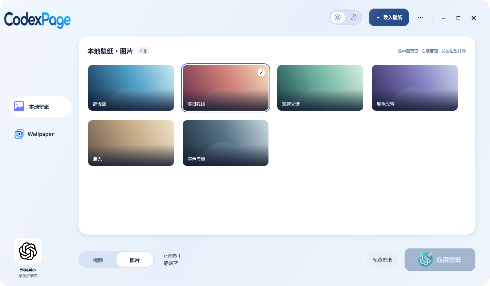

  

为你的 Codex 换上喜欢的图片或动态背景。导入、预览、切换，在一个窗口里完成。

  <a href="https://github.com/JiPaiFan1109/CodexPage/releases/latest/download/CodexPage-Setup.exe"><strong>下载 Windows 安装版</strong></a>
  · <a href="README.en.md">English</a> · <a href="CHANGELOG.md">更新记录</a>

  
  
  

本项目是社区开发的独立工具，**非 OpenAI 官方产品，与 OpenAI 无隶属关系**。使用前请安装官方版 Codex。

## 界面与功能

  

CodexPage 壁纸库界面。图中为原创演示素材，不随应用预置。

- **自动识别 Codex**：打开 CodexPage 即可自动连接到本机Codex。
- **图片与视频背景**：导入本地图片或视频，为 Codex 更换背景。
- **Wallpaper Engine 导入**：打开CodexPage即可自动寻找到本机Wallpaper壁纸地址。兼容图片和视频直接调用原文件，不额外复制占用空间；需要转换的素材会占用缓存空间。
- **壁纸收藏库**：卡片浏览、图片/视频分类、大图预览、视频静音播放；右键可预览、应用、重命名或删除，右上管理面板可查看关于软件。
- **随时恢复**：右上角设置中心里可随时恢复 Codex 原始外观。

查看 Codex 动态背景效果

[观看完整 MP4 演示](docs/media/earth-demo.mp4) · [获取演示中的地球背景](docs/earth-background.md)

演示录自真实 Codex 窗口，已检查并排除敏感个人信息。地球原视频不随应用分发，需按素材作者要求自行获取。

## 安装与使用

需要 **Windows x64**，并已安装 **Microsoft Store 官方版 Codex**。

**磁盘占用**：3.4.0 应用本体约 **100 MB**（含运行环境，不含用户壁纸）；按需下载的 FFmpeg、媒体缓存及更新文件另占空间。

1. [下载安装包](https://github.com/JiPaiFan1109/CodexPage/releases/latest/download/CodexPage-Setup.exe)，双击运行。
2. 打开 **CodexPage**，点击 **导入壁纸**，选择图片或视频。
3. 选中壁纸，点击 **应用壁纸**。如提示重启 Codex，请先保存工作再确认。

**升级**：退出 CodexPage 后安装到原目录，无需卸载，壁纸库与设置保留；完成后重新应用壁纸。

每天首次打开时检查更新，发现新版后居中提示。确认更新后自动下载、校验并安装；跳过只针对该版本。右上角“检查更新”可立即检查，并可重新查看被跳过的版本。

## 重要更新

| 日期（北京时间） | 版本 | 更新内容 |
| --- | --- | --- |
| 2026-11-07 | [3.6.0](https://github.com/JiPaiFan1109/CodexPage/releases/tag/v3.6.0) | 图库与后台效率、预览缓存预算、导入诊断和可访问名称 |
| 2026-11-05 | [3.5.0](https://github.com/JiPaiFan1109/CodexPage/releases/tag/v3.5.0) | 日夜模式、专注预览、图片与视频标签统一，以及启动与壁纸切换可靠性修复 |
| 2026-11-04 | [3.4.0](https://github.com/JiPaiFan1109/CodexPage/releases/tag/v3.4.0) | 每日首次打开检查更新、居中公告与确认后自动下载安装，修复图库无法翻页 |
| 2026-11-04 | [3.3.1](https://github.com/JiPaiFan1109/CodexPage/releases/tag/v3.3.1) | 修复更新交接和后台 PowerShell 弹窗，优化连接与壁纸应用速度 |
| 2026-11-03 | [3.3.0](https://github.com/JiPaiFan1109/CodexPage/releases/tag/v3.3.0) | 壁纸右键管理、新增关于软件；保留并验证应用后壁纸误回跳修复 |
| 2026-11-02 | [3.2.0](https://github.com/JiPaiFan1109/CodexPage/releases/tag/v3.2.0) | 改善后台恢复与重连提示，保存失败时保留调整，修复图库目录异常和损坏预览的处理 |
| 2026-10-30 | [3.1.1](https://github.com/JiPaiFan1109/CodexPage/releases/tag/v3.1.1) | 开始菜单统一为 CodexPage 单入口，清理已知旧快捷方式 |
| 2026-10-28 | [3.1.0](https://github.com/JiPaiFan1109/CodexPage/releases/tag/v3.1.0) | 修复后台目录污染与重复后台升级阻塞，先加载壁纸库再连接 |

[3.6.0 发布说明](docs/releases/v3.6.0.md) · [完整更新记录](CHANGELOG.md)

## 素材与常见问题

### 支持的素材

| 类型 | 要求 |
| --- | --- |
| 图片 | PNG、JPG/JPEG、WebP、BMP、TIFF、AVIF，最大 10 MiB；BMP/TIFF/AVIF 转为 PNG |
| 视频与动图 | 支持常见视频及 GIF/APNG，原文件最大 2 GiB；兼容 H.264 MP4（≤1080p/60fps、≤128 MiB）直接复制，其他视频转换为静音 MP4；预览与应用均静音 |

转换使用按需下载的 FFmpeg 解码和 Windows Media Foundation 编码。导入失败时可先导出为 H.264 MP4；视频过长或转换后超过限制时，请缩短后重新导入。应用不会自动截取视频。

默认背景为项目生成的 **Night Sky** 图片。演示中的地球背景请按[素材获取说明](docs/earth-background.md)自行获取。

导入细节与限制

Steam 导入先处理兼容文件，再询问是否转换剩余项目。首次转换视频、动图或 AVIF 时需要联网下载并校验 FFmpeg，之后复用缓存；安装包不含 FFmpeg。

Steam 兼容图片和视频直接引用源文件；删除源文件或断开所在磁盘后，壁纸会暂时不可用，重新连接后可刷新列表。其他支持的媒体转换后缓存，仍关联 Steam 源文件。Scene、Web 仅导入预览图或预览动画，不支持完整互动场景及应用项目。旧版 Steam 副本在刷新并确认原文件一致后转为引用，正在使用的副本暂缓清理。

可直接导入的 H.264 MP4 需满足：不超过 1920 × 1080、60 fps、128 MiB，音轨为 AAC 或无音轨。需要转码的视频由 FFmpeg 解码、Windows Media Foundation 编码，输出最高 1920 × 1080、30 fps，并移除音轨；直接导入的视频播放时同样静音。

图片每边不超过 16,384 像素，总计不超过 5,000 万像素；转换后仍须小于等于 10 MiB，多页 BMP/TIFF 不支持。扩展名符合要求不代表一定能够解码。

### 卸载与常见问题

- **卸载**：从 Windows「已安装的应用」卸载。卸载前会执行外观恢复；取消或失败时停止卸载。壁纸库默认保留。
- **未找到 Codex**：确认当前 Windows 用户已安装官方 Store 版客户端，再点击左下角连接图标重试。
- **从官方入口打开后没有皮肤**：回到 CodexPage 重新应用壁纸，按提示处理正在运行的会话。
- **Codex 更新后换肤失败**：页面结构和启动方式可能变化，请查看项目新版及 [Releases](https://github.com/JiPaiFan1109/CodexPage/releases)。

## 技术说明与源码构建

运行环境、数据位置及兼容安装方式（日常使用可跳过）

- 安装时可选择有写入权限的目录，默认 `%LOCALAPPDATA%\CodexDynamicSkin`，无需管理员权限；壁纸库位于所选目录中的 `wallpaper-library`。重装默认沿用原目录，自动更新写回当前目录；更换目录不会自动迁移旧壁纸库。
- 通过本机注册的官方 Codex 安装信息完成检测，并由本地引擎启动和应用背景。绿色连接状态表示已核验真实调试会话；找到安装但未建立连接时仍可通过应用壁纸启动连接。
- 默认安装、启动和恢复流程不改写全局 `%USERPROFILE%\.codex\config.toml`。兼容旧状态的恢复保护逻辑仍保留。
- 发行包固定使用 Node.js 24.22.1 x64 及其许可证，构建时核对 SHA-256 和 OpenJS Foundation 签名。本项目 EXE 尚无项目代码签名证书；上游 Node.js 签名不代表安装程序已签名，不要求关闭 Windows 安全保护。
- 仍提供 [Release ZIP](https://github.com/JiPaiFan1109/CodexPage/releases)：完整解压后运行 `Install.cmd`。GitHub 自动生成的源码 ZIP 不含运行环境。
- 程序运行和视频播放会占用内存及 CPU/GPU；不承诺所有 Codex 版本兼容或完全没有性能开销。

开发与验证：[构建说明](docs/windows-application.md) · [3.2.0 验证记录](docs/releases/v3.2.0-validation.md) · [安全说明](SECURITY.md)

历史记录：[0.2.0 安装应用验证](docs/windows-application-validation.md) · [0.2.0 上线前清理审查](docs/pre-release-audit.md)

## 开源来源与许可证

本项目基于 [Codex Dream Skin](https://github.com/Fei-Away/Codex-Dream-Skin) v1.5.18 开发，保留必要的本地换肤、启动和恢复实现。

项目代码按 **[MIT License](LICENSE)** 提供，保留上游 `Copyright (c) 2026 Codex Dream Skin Studio contributors` 声明。[第三方声明](THIRD_PARTY_NOTICES.md)列出上游来源、Node.js 许可及素材使用边界。MIT 不覆盖第三方壁纸、OpenAI 品牌或官方应用资源。

## 打赏作者一杯蜜雪冰城喝

如果这个小工具对你有帮助，欢迎支持后续维护。

  

